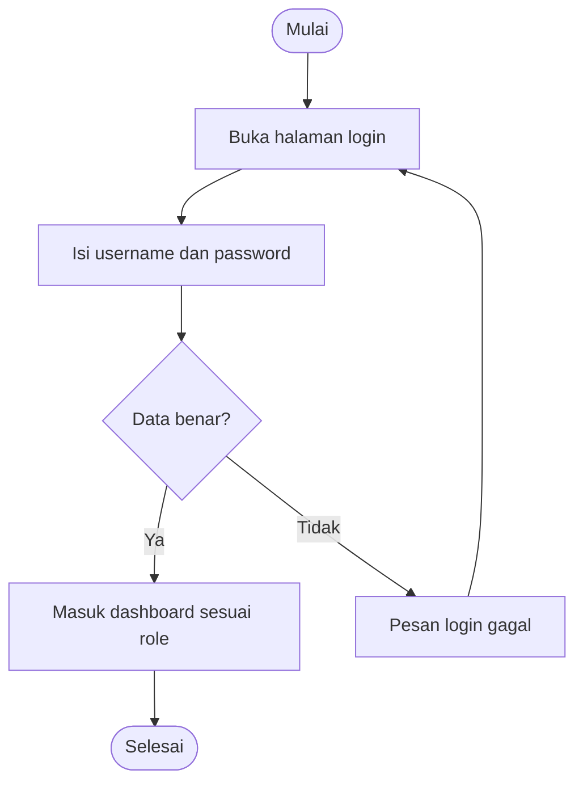
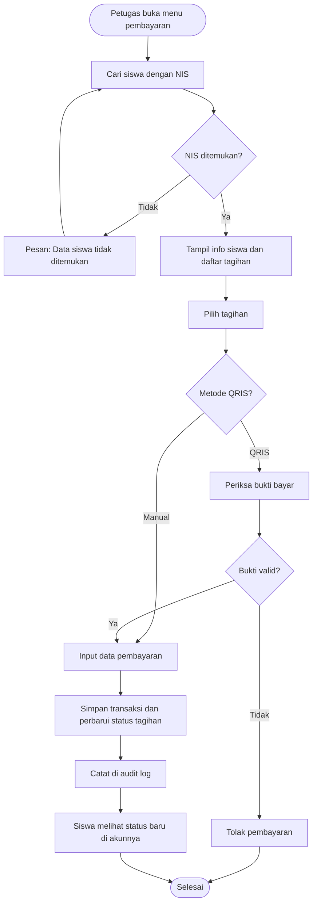
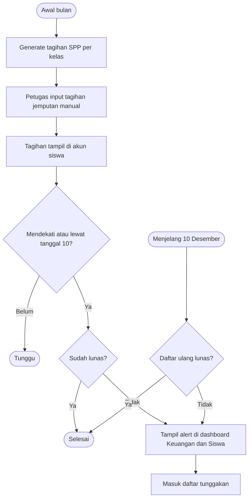
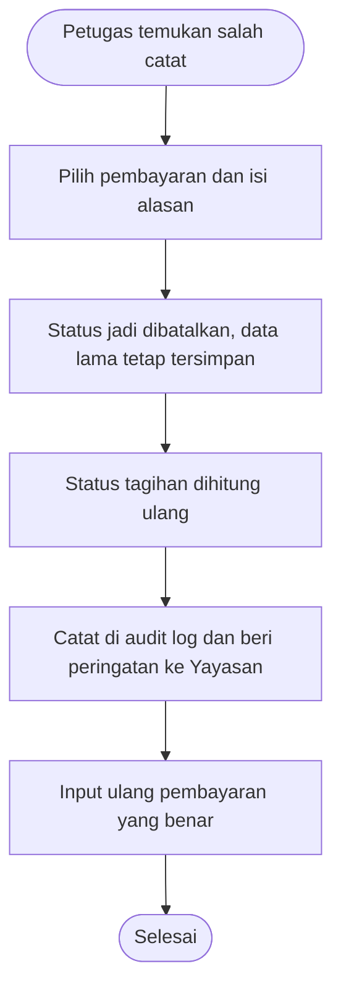

# PRD: SIAPA

Sistem Informasi Administrasi Pembayaran Abu Bakar, SDIT Abu Bakar Ash Shiddiq Rajapolah.

## 1. Tujuan

Menggantikan pencatatan pembayaran manual dengan satu sistem yang mencatat SPP, daftar ulang, dan jemputan per siswa, menampilkan tunggakan, dan memberi peringatan sebelum jatuh tempo.

## 2. Pengguna

| Role | Kebutuhan utama |
|---|---|
| Admin | Kelola pengguna, data siswa, akun siswa |
| Kepala Sekolah / Yayasan | Lihat informasi, riwayat, rekap, dan laporan |
| Petugas Keuangan | Kelola tagihan, catat pembayaran manual dan QRIS, nominal jemputan, tunggakan |
| Siswa (orang tua) | Login, lihat tagihan, riwayat, dan status pembayaran |

## 3. Aturan bisnis

**Tarif SPP per bulan**

| Kelas | Nominal |
|---|---|
| 1 | Rp590.000 |
| 2 | Rp550.000 |
| 3 sampai 6 | Rp540.000 |

**Daftar ulang:** kelas 2 Rp3.500.000, kelas 6 Rp3.200.000.

**Jemputan:** nominal diinput manual oleh Petugas Keuangan.

**Jatuh tempo**
- SPP dan jemputan: sebelum tanggal 10 setiap bulan.
- Daftar ulang: 10 Desember.

**Identitas siswa:** NIS adalah primary key.

**Pembayaran:** manual (tunai) dan QRIS. Bukti QRIS diperiksa dan dikonfirmasi Petugas Keuangan, tidak otomatis.

## 4. Kebutuhan fungsional

Mengacu ke use case di folder diagram (paket A sampai E).

**A. Autentikasi**
- F1. Login dan logout, tampilan sesuai role.

**B. Data siswa**
- F2. CRUD pengguna.
- F3. Daftarkan siswa (NIS, nama, kelas).
- F4. Buat dan aktifkan akun siswa.

**C. Informasi pembayaran**
- F5. Siswa melihat tagihan, riwayat, dan status.

**D. Transaksi**
- F6. Generate dan kelola tagihan (SPP bulanan, daftar ulang, jemputan).
- F7. Catat pembayaran manual.
- F8. Periksa bukti QRIS lalu terima atau tolak.
- F9. Kelola nominal jemputan.
- F10. Daftar tunggakan.
- F11. Pantau status pembayaran.

**E. Laporan**
- F12. Rekap pembayaran dan tunggakan.
- F13. Laporan seluruh pembayaran.

**Peringatan (dari catatan klien, belum ada di diagram)**
- F14. Alert warning bila SPP atau jemputan belum lunas mendekati atau melewati tanggal 10.
- F15. Alert daftar ulang menjelang 10 Desember.

## 5. Alur (flow)

Diagram di bawah memakai Mermaid dan tampil otomatis di GitHub. Alur login dan pembayaran mengikuti activity diagram di Google Drive. Alur tagihan, pembatalan, dan alert adalah tambahan dari catatan klien dan belum ada di diagram.

### 5.1 Login

### 5.2 Pembayaran

### 5.3 Tagihan bulanan dan alert

### 5.4 Pembatalan pembayaran (salah catat)

## 6. Di luar cakupan awal

- Verifikasi QRIS otomatis lewat payment gateway.
- Pengiriman WhatsApp ke orang tua (menunggu jawaban klien).
- Denda keterlambatan (menunggu jawaban klien).

## 7. Pertanyaan terbuka untuk klien

1. Daftar ulang hanya kelas 2 dan 6, atau kelas lain juga?
2. Jemputan: nominal tetap atau berbeda per siswa/jarak? Siapa yang menentukan?
3. Lewat tanggal 10: ada denda atau hanya peringatan?
4. Apakah sekolah punya QRIS sendiri?
5. Pengingat: tampil di sistem saja atau juga WhatsApp?
6. Orang tua login sendiri (diasumsikan ya, sesuai diagram).

## 8. Kriteria selesai

- Semua F1 sampai F13 berjalan sesuai role.
- Alert F14 dan F15 tampil sesuai tanggal.
- NIS unik dan tidak bisa duplikat.
- Siswa hanya bisa melihat data miliknya sendiri.
